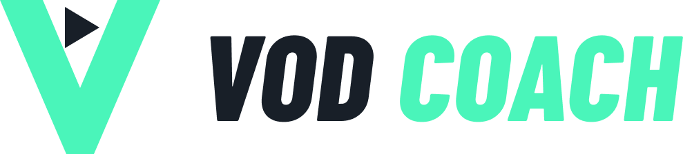

  <picture>
    <source media="(prefers-color-scheme: dark)" srcset="assets/wordmark.png">
    
  </picture>

**VOD Coach** watches your full VALORANT or League of Legends match and coaches you like a real analyst. Every mistake
and good play gets a clickable timestamp, an explanation of what happened, and what you should have done instead,
specific to your agent or champion, your rank, and even your lane opponent.

- 🎯 Timestamped notes: click one and the video jumps there
- 🧠 Knows every agent's and champion's real abilities, kept up to date automatically
- 👎 Disagree with a note? Tell it why, and it remembers for future reviews
- 🆓 Free: uses your own Google Gemini key (about a minute to set up, no credit card)
- 🔒 Your key stays on your PC; uploaded videos are deleted after analysis

## Download

1. Go to the **[Releases](https://github.com/TsakasOptimizations/VOD_Coach/releases/latest)** page.
2. Under **Assets**, download **`VODCoach.exe`**.
3. Double-click it. No install and no Python needed.

> **"Windows protected your PC"?** That's normal for new apps from small developers.
> Click **More info** → **Run anyway**.

The first time you open it, the app walks you through getting your free Gemini key: open AI Studio, click
**Create API key** → **Create key**, copy the key, and paste it into the app.

## How to use

1. **Open VOD** and pick your full match recording (OBS, Outplayed, Medal, Twitch VOD...).
2. Pick the game, your agent or champion (plus role and lane opponent for League) and your rank.
3. Optionally, tell the coach what to focus on.
4. Click **Analyze match**. A 30 minute game takes a few minutes.

The report is saved next to the video (`yourvod.mp4.coach.json`), so reopening that video later shows it instantly.

**Free limits:** each coach gets a daily free allowance from Google. The app shows how many free VOD reviews you have
left and switches to the next coach automatically when one runs out. Limits reset every day at midnight Pacific time.

## Updates

Click **Check for updates** at the top of the app. If a new version is out, click **Download it** to open the
Releases page, then download the new `VODCoach.exe` and use it instead of the old one. Your key, settings and
saved reports carry over automatically.

## Teaching the coach

Click **Disagree** under any timeline note and (optionally) say why. Your corrections are given to the coach on every
future analysis, so it stops repeating advice that doesn't fit how you play. **undo** removes one.

## Privacy

- Your API key is saved only on your PC (`~/.vodcoach.json`). Don't share it with anyone.
- The video is compressed, uploaded to Google Gemini for analysis, then deleted from Google's servers.
- Your disagreements are stored locally in `~/.vodcoach_feedback.json`.

## For developers

Run from source (Python 3.10+): double-click `run.bat`.

Build the .exe: double-click `build.bat`. It creates `dist\VODCoach.exe`. Errors from the .exe are written to
`~/.vodcoach.log`.

Releasing a new version:
1. Bump `VERSION` in `app.py` (e.g. `"1.2"`) and run `build.bat`.
2. Create a GitHub Release tagged `v1.2` and attach `dist\VODCoach.exe`.
3. Everyone's **Check for updates** button compares their `VERSION` with the latest release tag.

Microsoft Store package: double-click `build_store.bat`. It creates `dist\VODCoach.msix` (the Store signs it when
you upload it in Partner Center). Before each Store release, bump `VERSION` in `app.py` and `Version="x.y.0.0"` in
`store\AppxManifest.xml`. The Store version hides the GitHub update checker, because the Store handles updates.

Ability, champion and rank data comes live from valorant-api.com, Riot's Data Dragon and CommunityDragon, cached in
`~/.vodcoach_cache/` (the copies in this repo are the offline fallback).

---
VOD Coach isn't endorsed by Riot Games and doesn't reflect the views or opinions of Riot Games or anyone officially
involved in producing or managing Riot Games properties. Riot Games, VALORANT and League of Legends are trademarks or
registered trademarks of Riot Games, Inc.
